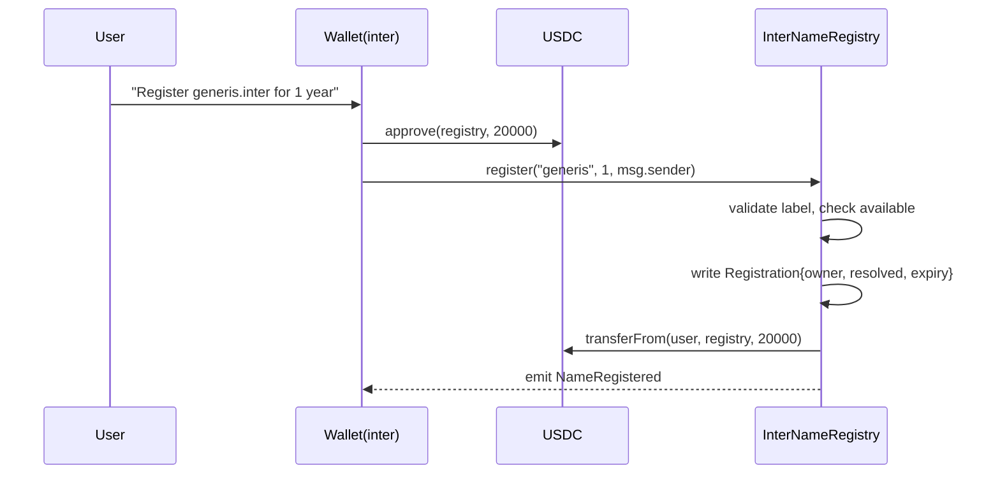
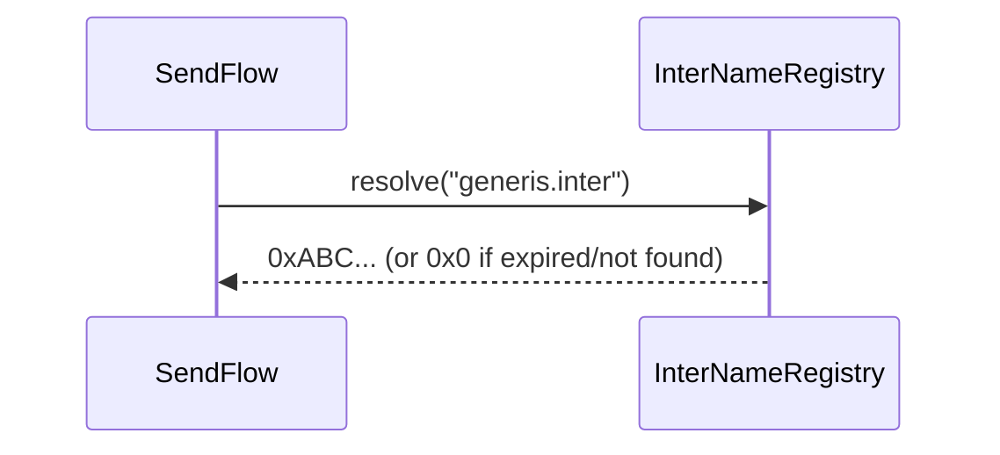

# InterNameRegistry — Smart Contract Design Doc

**Status:** Draft  
**Authors:** Generis2001  
**Target chain:** Arc Mainnet (chain ID 5042, EVM Paris)  
**Language / toolchain:** Solidity 0.8.28, Foundry (forge)  
**Milestone:** MVP — register `.inter` names, pay USDC, resolve to address  

## Review Tracker

- [ ] Design review
- [ ] Security review
- [ ] Ops review

---

## Action Items (living)

_Empty at first draft — fill after each review round._

---

## 1. Goals / Non-Goals

### Goals
- Let any EOA or contract wallet register a human-readable name ending in `.inter` (e.g. `generis.inter`) by paying a time-based USDC fee.
- Map each name to exactly one address at any given time (forward resolution: name → address).
- Map each address to at most one primary name (reverse resolution: address → name).
- Allow name owners to transfer names, set a new target address, or let their registration expire.
- Let the contract owner withdraw accumulated USDC fees and update the fee rate.
- Resolve names inside the inter wallet's send flow (type `generis.inter`, get `0xABC…`).

### Non-Goals
- Subdomain support (e.g. `sub.generis.inter`) — not in scope.
- Off-chain metadata / avatar / text records — not in scope for v1.
- Cross-chain resolution — names resolve on Arc mainnet only.
- Name auctions, secondary market mechanics, or premium pricing for short names.
- ERC-721 tokenization of names — names are registry records, not NFTs, in v1.
- Governance / DAO — owner is a single EOA/multisig.

---

## 2. Requirements

### Functional
- F1. Anyone can register a name for 1–N years by paying `0.02 USDC × years` into the contract.
- F2. Registration is first-come-first-served; a name cannot be registered while it has an unexpired owner.
- F3. Owner can renew their name (extend expiry) at the same rate at any time.
- F4. Owner can transfer the name to another address.
- F5. Owner can set the resolved address to any address (default: registrant address).
- F6. Owner can set or clear their primary name (reverse record).
- F7. After expiry, anyone can register the name; the old owner loses it silently.
- F8. Contract owner can change the annual fee rate and withdraw USDC balance.
- F9. Forward resolution returns the zero address for expired or unregistered names.
- F10. The inter frontend can resolve `.inter` names via a public `resolve(string)` view.

### Security
- S1. No path lets a non-owner modify, transfer, or renew a live registration.
- S2. USDC is transferred into the contract via `transferFrom`; the contract never holds raw ETH.
- S3. Expiry is stored as `uint64` block timestamp; no path overflows it within any realistic registration window.
- S4. Name strings are normalized on-chain (lowercase ASCII + digits + hyphens, max 64 chars) before hashing; no two different raw strings hash to the same normalized key.
- S5. Fee transfer uses `SafeERC20`; a failing USDC transfer reverts the entire registration.
- S6. No reentrancy risk: state is written before any external call (CEI).
- S7. Owner cannot renounce ownership to the zero address (two-step transfer).

---

## 3. Terminology & Actors

| Term | Definition |
|---|---|
| Name | A UTF-8 string ending in `.inter`, e.g. `generis.inter`. The label (`generis`) is the part before `.inter`. |
| Label | The part before `.inter`. Stored as a `bytes32` keccak256 hash of its normalized form. |
| Registration | A record mapping a label hash to (owner, resolvedAddress, expiry). |
| Primary name | The reverse record: an address's chosen `.inter` name for display. |
| Resolved address | The address a name points to. Defaults to the registrant; changeable by owner. |
| Annual fee | 0.02 USDC (2000 units at 6 decimals) per year. |

| Actor | On/off-chain | Trust level | What they can do |
|---|---|---|---|
| Registrant | On-chain EOA or wallet | Untrusted | Register, renew, transfer, set resolved address, set/clear primary name |
| Contract owner | On-chain EOA (deployer, later multisig) | Trusted | Set fee rate, withdraw fees, propose ownership transfer |
| Pending owner | On-chain EOA | Semi-trusted (accepted) | Accept ownership transfer |
| Public | Any caller | Untrusted | Read: resolve, lookupAddress, expiry, isAvailable |

---

## 4. Language / Runtime

- **Solidity 0.8.28** — built-in checked arithmetic; no SafeMath needed.
- **EVM target: Paris** — Arc mainnet runs Paris; no `PUSH0`, no `mcopy`. OpenZeppelin 5.1.0 (already pinned in the sandbox; compatible with Paris).
- **Foundry (forge)** — compile + test. `evm_version = "paris"` in foundry.toml.
- **Base contracts:** `Ownable2Step` (OZ 5.1.0) for two-step ownership; `ReentrancyGuard` (OZ 5.1.0) for defense-in-depth; `SafeERC20` (OZ 5.1.0) for USDC transfers.

---

## 5. Transaction & Execution Model

Every function is atomic (EVM). Execution is CEI throughout:
1. **Check** — validate caller, name, payment amount, availability.
2. **Effect** — write state (registration, expiry, reverse record).
3. **Interact** — call USDC `transferFrom` / `transfer` last.

Reentrancy surface: `register`, `renew`, `withdraw`. All three call an external ERC-20 contract (`USDC`). `nonReentrant` guards each. No ETH is accepted; no `receive()` / `fallback()`.

---

## 6. Chain Standards & Interfaces

No ERC token standard. The registry exposes a custom ABI only. No ERC-721 in v1 (names are not transferable NFTs).

External dependency: USDC on Arc mainnet at `0x3c499c542cEF5E3811e1192ce70d8cC03d5c3359` — confirmed 6 decimals, standard ERC-20 `transferFrom`.

---

## 7. Architecture Overview





**Flow of funds:**

| Step | Who moves what | Invariant |
|---|---|---|
| Registration | User → Registry: `fee × years` USDC | Registry USDC balance increases by exactly `fee × years` |
| Renewal | User → Registry: `fee × additionalYears` USDC | Same |
| Withdrawal | Registry → Owner: full USDC balance | Registry USDC balance returns to 0 |
| Resting state | — | Registry holds accumulated fees until owner withdraws |

---

## 8. Contract Design

### Roles

| Role | Holder | Permissions | Blast radius if compromised |
|---|---|---|---|
| `owner` | Deployer EOA (→ multisig post-deploy) | Set fee rate, withdraw fees, propose ownership transfer | Drain all accumulated fees; change fee to 0 or arbitrarily high; cannot steal user names |
| Name owner | Registrant | Renew, transfer, set resolved address, set/clear primary name | Lose their name; point it at wrong address |

### Storage layout

```solidity
struct Registration {
    address owner;        // 20 bytes
    address resolved;     // 20 bytes — packed into separate slot
    uint64  expiry;       // unix timestamp
}

mapping(bytes32 => Registration) private _names;      // label hash → record
mapping(address => string)       private _primary;    // address → primary name label
uint256 public annualFee;                             // USDC units (6 decimals), default 20000 (= 0.02 USDC)
address public immutable usdc;                        // USDC contract address
```

No upgradeable proxy in v1 — immutable deployment. No `__gap` needed.

### Key functions (writes)

| Function | Caller | State mutated | Events | Reverts when |
|---|---|---|---|---|
| `register(label, years, resolvedTo)` | Anyone | `_names[hash]` created | `NameRegistered` | Name taken & unexpired; invalid label; years=0; USDC transfer fails |
| `renew(label, additionalYears)` | Name owner | `_names[hash].expiry` extended | `NameRenewed` | Not owner; years=0; USDC transfer fails |
| `transfer(label, newOwner)` | Name owner | `_names[hash].owner` updated | `NameTransferred` | Not owner; expired; newOwner=0 |
| `setResolved(label, addr)` | Name owner | `_names[hash].resolved` updated | `ResolvedAddressSet` | Not owner; expired |
| `setPrimaryName(label)` | Any address | `_primary[msg.sender]` set | `PrimaryNameSet` | Caller is not the resolved address of that name; expired |
| `clearPrimaryName()` | Any address | `_primary[msg.sender]` cleared | `PrimaryNameCleared` | — |
| `setAnnualFee(newFee)` | Owner | `annualFee` updated | `AnnualFeeUpdated` | Not owner |
| `withdraw()` | Owner | USDC transferred to owner | `FeesWithdrawn` | Not owner; USDC transfer fails |
| `transferOwnership(newOwner)` | Owner | pending owner set | — | Standard Ownable2Step |
| `acceptOwnership()` | Pending owner | owner updated | — | Standard Ownable2Step |

### Key functions (reads)

| Function | Returns |
|---|---|
| `resolve(nameWithSuffix)` | Resolved address, or `address(0)` if expired/unknown |
| `lookupAddress(addr)` | Primary name string for an address (empty if none) |
| `isAvailable(label)` | `true` if unregistered or expired |
| `expiryOf(label)` | `uint64` unix timestamp; 0 if never registered |
| `ownerOf(label)` | Owner address; `address(0)` if expired |

### Events

| Event | Parameters | When |
|---|---|---|
| `NameRegistered` | `bytes32 indexed labelHash, string label, address indexed owner, address resolved, uint64 expiry` | Successful registration |
| `NameRenewed` | `bytes32 indexed labelHash, address indexed owner, uint64 newExpiry` | Successful renewal |
| `NameTransferred` | `bytes32 indexed labelHash, address indexed from, address indexed to` | Ownership transfer |
| `ResolvedAddressSet` | `bytes32 indexed labelHash, address indexed resolved` | Resolved address change |
| `PrimaryNameSet` | `address indexed addr, string label` | Primary name set |
| `PrimaryNameCleared` | `address indexed addr` | Primary name cleared |
| `AnnualFeeUpdated` | `uint256 oldFee, uint256 newFee` | Fee rate change |
| `FeesWithdrawn` | `address indexed to, uint256 amount` | Fee withdrawal |

---

## 9. Security Considerations

| Vulnerability | Applicable? | Mitigation |
|---|---|---|
| Reentrancy | Yes — `register`, `renew`, `withdraw` call USDC | CEI ordering + `nonReentrant` on all three |
| Access control | Yes | `onlyOwner` for admin; name-owner check on every write |
| Integer overflow/underflow | Solidity 0.8 checked | `expiry` is `uint64`; max value ~year 584,542 — no realistic overflow |
| Unchecked external call | Yes — USDC `transferFrom` | `SafeERC20.safeTransferFrom`; reverts on failure |
| Fee-on-transfer tokens | USDC is not fee-on-transfer | N/A — USDC is trusted Circle-issued contract |
| Signature replay | No signatures used | N/A |
| Front-running / MEV | Registration race | Acceptable — first-come-first-served; no commit-reveal needed at this fee level |
| Flash-loan / price manipulation | No price oracle | N/A |
| Oracle manipulation | No oracle | N/A |
| Denial of service | Bounded label (max 64 chars); no loops over unbounded sets | pull-over-push on withdrawals; no per-user loops |
| Delegatecall / proxy safety | No proxy in v1 | N/A |
| Timestamp dependence | Expiry uses `block.timestamp` | Acceptable — registration windows are years; ±15s miner bias is irrelevant |
| Approval persistence | User approves registry before calling register | Exact-amount approval recommended; frontend sets `fee × years` exactly |
| Centralization risk | Owner can change fee and withdraw fees | Fee changes emit events; multisig ownership recommended post-deploy |
| Label collision | Two strings hashing to same `bytes32` | keccak256 is collision-resistant; normalized before hashing |
| Empty / invalid labels | `register("")` | Validated: min 1 char, max 64 chars, only `[a-z0-9-]`, no leading/trailing hyphen |

---

## 10. Trust Model & Threat Analysis

| Actor | Worst case if compromised | Mitigation |
|---|---|---|
| `owner` key | Drain all accumulated fees; set fee to 0 (free registrations) or arbitrarily high (DoS) | Move to multisig post-deploy; fees capped at a max in contract |
| Name owner key | Attacker transfers their name away or points it at a wrong address | User responsibility; no protocol-level recovery in v1 |

---

## 11. Emergency Response

- **No pause mechanism in v1** — contract is simple enough that pausing is not warranted; risk surface is fees only.
- **Fee drain** — owner calls `withdraw()` to move fees to safety.
- **Stuck USDC (sent directly, not via register)** — `withdraw()` sweeps the full USDC balance; any accidentally-sent USDC is recovered by the owner.
- **Upgrade / migration** — no proxy; if a bug requires a fix, deploy a new registry at a new address and update the inter app config. Old registrations stay on the old contract; new registrations go to the new one.

---

## 12. Deployment & Initialization

- **Constructor args:** `usdc address`, `initialAnnualFee` (20000 = 0.02 USDC), `initialOwner`
- **No proxy** — constructor only, `immutable usdc`.
- **Deploy wallet:** Arc Studio deployer (`0x5B12Ce46C7194aD57d143bC22847224047b1Ef42`) via Mode 1 `deploy_contract` tool.
- **Post-deploy:** owner should transfer to a multisig for production use.

---

## 13. Upgradeability

Not upgradeable in v1. Migration story: deploy `InterNameRegistryV2` at a new address; update `INTER_REGISTRY_ADDRESS` in the inter app config; existing names stay valid on the v1 contract until expiry.

---

## 14. Testing Strategy

- **Unit tests (Foundry):** happy-path register/renew/transfer/resolve; revert paths (expired, wrong caller, invalid label, zero years); fuzz `annualFee × years` overflow guard; event emission.
- **Slither:** run on `InterNameRegistry.sol`; treat High + Medium as actionable.
- **Fork test (pre-deploy):** fork Arc mainnet, impersonate a USDC holder, register a name, resolve it.
- **Coverage target:** 90%+ branch coverage.

---

## 15. Third-party Libraries

| Library | Version | Already a dep? | Why | Security reviewed? |
|---|---|---|---|---|
| OpenZeppelin Contracts | 5.1.0 | Yes (pinned) | `Ownable2Step`, `ReentrancyGuard`, `SafeERC20` | Audited by OZ + community |

---

## 16. Worked Example

**Register `generis.inter` for 2 years:**

1. User calls `USDC.approve(registryAddress, 40000)` — 0.04 USDC.
2. User calls `registry.register("generis", 2, userAddress)`.
3. Contract normalizes `"generis"`, hashes to `bytes32 labelHash`.
4. Checks: label valid, `isAvailable("generis") == true`, `years > 0`.
5. Writes `_names[labelHash] = Registration{owner: user, resolved: user, expiry: block.timestamp + 2*365 days}`.
6. Calls `USDC.transferFrom(user, registry, 40000)`.
7. Emits `NameRegistered(labelHash, "generis", user, user, expiry)`.

**Resolve `generis.inter` in the Send flow:**

1. Frontend calls `registry.resolve("generis.inter")`.
2. Contract strips `.inter` suffix, normalizes, hashes.
3. Looks up `_names[labelHash]`; checks `expiry > block.timestamp`.
4. Returns `_names[labelHash].resolved` (or `address(0)` if expired).
