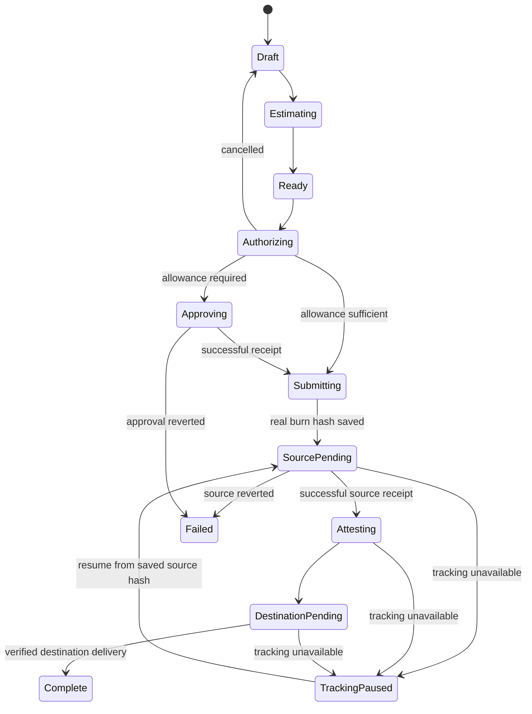

# Inter: USDC bridge into and out of Arc

Repository and public Tower documentation reviewed on 2026-11-07. This is the original design study. The bridge is now implemented; see [the current implementation and setup guide](bridge-implementation.md). No funded settlement has been exercised.

## Agreed scope and recommended first release

The user confirmed **USDC into and out of Arc**. Every supported route must have Arc as one endpoint. Keep the existing mainnet/testnet setting and prohibit routes between environments.

Start with Arc ↔ Base and Arc Testnet ↔ Base Sepolia, then expand the EVM chain list after both directions pass settlement and recovery tests. Tower lists Ethereum, Arbitrum, Optimism, Avalanche, Polygon, Linea, Sonic, Unichain, and corresponding test networks in its deployed bridge application. Being listed does not prove every route is currently operational. Solana would require a separate account model and is outside this initial EVM implementation.

Recommended initial recipient: the active Inter address on both chains. Inter's locally derived EVM account can sign on either chain. Users bridging into Arc must first hold USDC and the source chain's gas token at that Inter address. Bridging directly from a separate connected wallet would need an additional source-wallet flow; it is not implied by reusing Inter's signer.

## How Inter actually works

The source is more current than the placeholder AGENTS.md and older implementation plans.

| Area | Current implementation | Consequence for bridging |
| --- | --- | --- |
| Wallet | `src/context/WalletContext.tsx` creates/imports viem HDAccount or PrivateKeyAccount; `src/utils/vault.ts` encrypts the vault in localStorage. Unlock reconstructs a local signer; lock clears React state. | Reuse the account locally. Tower must not receive a mnemonic, private key, PIN, or decrypted vault. The app is not primarily an injected-wallet UI despite its wagmi connector configuration. |
| Network | `src/context/NetworkContext.tsx` selects Arc 5042 or Arc Testnet 5042002; defaults to mainnet. | Preserve the wallet's Arc network selection and manage source/destination selection within the bridge. |
| Providers | `src/main.tsx` supplies wagmi, React Query, and ConnectKit. `src/config.ts` configures Arc, Arc Testnet, and Ethereum for ENS. | Bridge balances and transactions need additional chain clients; chain definitions in the facts registry alone do not configure wagmi transports. |
| Navigation | `src/App.tsx` conditionally mounts screens. `BottomNav.tsx` already has five visible tabs; Assets is reachable through other navigation. | Put a Swap/Bridge switch in the existing Swap area and a Bridge shortcut on Home. Keep bridge execution and recovery above conditional screen mounts. |
| Tower swaps | `src/hooks/useTowerSwap.ts` quotes, builds unsigned transactions, signs approvals locally, then signs the swap. `useSwap.ts` selects Tower or Uniswap v4. | Reuse presentation and confirmation components; implement an independent bridge service/state machine. The swap API is not a bridge transaction builder. |
| Money | `src/onchain-money.ts` provides bigint-backed Amount. `src/onchain-facts.ts` owns generated chain/USDC facts. | Keep money in integer base units. Import facts; do not edit generated registries or reuse Arc's USDC address on another chain. |
| Gas | Arc gas is USDC with 18 decimals; ERC-20 USDC uses 6. Current swap checks and error messages assume Arc. | Ethereum/Base gas is ETH, Avalanche gas is AVAX, etc. Estimate approval and burn fees on the source chain and destination fees if forwarding is unavailable. |
| Activity | `useArcTransactions.ts` merges explorer/RPC activity with local records; records lack a chain ID and bridge identity. | A bridge is one operation with multiple chain transactions. Its lifecycle cannot be represented by one Arc transaction receipt. |
| Approvals | `src/utils/allowances.ts` records spenders per wallet and reads/revokes them through an Arc mainnet client. | Add chain IDs to bridge allowances and read/revoke them on their actual chain. Use exact approvals by default. |
| Authorization | `PinVerificationModal.tsx` and `useRequireTxPin()` are shared by sends/swaps. Transaction PIN is an optional setting and defaults to false. | Apply the existing preference to bridge signing. Bind confirmation to a fixed account, route, amount, and fee snapshot. |
| Notifications | `useNotifications.ts` derives incoming/failed notifications from Arc history and deduplicates by hash. | Settlement notifications need operation/status identity and the correct chain for explorer links. |
| Distribution | Vite builds a static web app; Capacitor packages Android; Manifest V3 packages popup/side panel. | A secret-bearing Tower proxy must be hosted separately for installed clients. Reopening a popup or resuming Android must restore tracking. |

ANS remains an Arc feature and does not need contract changes for this bridge. No new Inter Solidity contract is required for a normal CCTP integration.

## Verified Tower interface

Official reference: <https://docs.tower.exchange/developer-console/api-reference/cross-chain-bridge>.

Tower documents:

```http
POST https://www.tower.exchange/api/public/bridge
Authorization: Bearer <server-side Tower API key>
Content-Type: application/json
```

```json
{
  "fromChainId": 5042002,
  "toChainId": 84532,
  "amount": "10.00",
  "token": "USDC",
  "recipientAddress": "<recipient EVM address>",
  "senderAddress": "<source EVM address>",
  "useForwarder": true
}
```

The documented response contains `success`, `transactionHash`, `status: "pending"`, and an estimated time. It describes `transactionHash` as the **source** transaction hash. Authentication requires the `bridges` scope; the documentation assigns the operation a cost of 5 CU.

The bridge amount is a decimal string, unlike the swap API's integer `inputAmount`. CCTP transfers native USDC by burning on the source and minting on the destination. Fees can reduce received USDC; do not interpret the documented 1:1 transfer as a zero-fee guarantee.

### The integration gap to resolve before signing

The public REST documentation does not describe:

- Returning unsigned approval/burn transactions to a self-custodial client.
- Supplying a user's local signatures or signed transactions.
- A bridge quote/estimate endpoint, supported-route discovery endpoint, or destination-status/recovery endpoint.
- How a server initiates the documented transaction using only sender/recipient addresses.
- Idempotency guarantees for resubmitting an initiation request.

An address is not signing authority. A server-side proxy protects an API key but does not solve this signing gap. Do not assume `/bridge/quote`, `/bridge/build-tx`, or `/bridge/status` exist. Do not ship an initiation button that treats the documented `pending` response as delivery.

The deployed Tower bridge UI provides useful architectural evidence: its public JavaScript includes Circle BridgeKit, viem adapters, local EIP-1193 signing, fee estimates, and forwarded-mint tracking. It uses a different workflow from the simple documented REST request. These internal helpers are not a published Tower SDK or a stable integration contract and should not be copied into Inter.

**Recommended execution decision:** obtain Tower's supported noncustodial bridge integration contract for locally signed transactions and settlement tracking. If that is its public API, integrate it through the hosted proxy and local signer. If Tower confirms a browser integration based on Circle kits, use that supported adapter path. Implementing Circle CCTP directly is feasible, but it should be described accurately as a Circle integration rather than claimed to be a Tower API integration.

Inter already declares `@circle-fin/app-kit` and `@circle-fin/adapter-viem-v2`, but does not currently import them for bridging. `@circle-fin/bridge-kit` is not a direct dependency. Verify the installed SDK's supported Arc chain definitions and local account adapter API before choosing dependencies; package declarations alone are not an implementation.

### Fees and network availability evidence

The deployed Tower application lists Arc 5042 and Arc Testnet 5042002 separately and prevents mixed-environment routes. It includes special handling for Arc mainnet's Circle chain definition. Do not copy its `Arc_Testnet` enum mapping into Inter and assume it represents mainnet without an explicit validated definition.

Read-only requests to Circle's production and sandbox fee APIs for Arc domain 26 → Base domain 6 returned fee data during this study:

- <https://iris-api.circle.com/v2/burn/USDC/fees/26/6?forward=true>
- <https://iris-api-sandbox.circle.com/v2/burn/USDC/fees/26/6?forward=true>

This establishes that fee data is published for that route; it does not establish successful settlement or validate Tower credentials. Reverse-direction settlement must also be tested. Obtain current fees for each requested direction and environment, and revalidate before signing.

Official authentication guidance: <https://docs.tower.exchange/developer-console/authentication>. Tower explicitly requires secret keys to remain on backend servers. Its SDK page says official TypeScript/Python SDKs are under development: <https://docs.tower.exchange/developer-console/sdks>.

## Existing issues that affect the bridge design

These are observations from the current source, not a general audit or fixes performed by this study.

1. **Tower secret embedded in the frontend.** `useTowerSwap.ts` contains an encoded fallback live API key and reads `VITE_TOWER_API_KEY`. Encoding does not protect a secret; Vite variables are bundled into clients. Rotate the exposed credential and move Tower requests to a server-side proxy. Do not copy the fallback into bridge code.
2. **History keys are not chain-specific.** `recordTransaction`, `getRecordedTransactions`, and `persistWalletTransactions` use the legacy mainnet key for Arc, and the same `testnet_` prefix for every other chain ID. Adding Base would collide with testnet storage. Migrate known Arc histories to wallet+chain keys before writing bridge chain transactions.
3. **Polling drops the selected chain when loading local records.** `fetchTxns()` calls `getRecordedTransactions(address)` without `chainId`. Testnet polling can therefore merge mainnet records into its result. Explorer/RPC merges also lack an independent bridge lifecycle.
4. **Tower-name heuristics classify activity as swaps.** `ActivityScreen.tsx` and `DashboardScreen.tsx` identify Tower-named transactions as swaps. Adding a Tower bridge requires an explicit bridge operation/type checked before these heuristics; approvals should also retain their own type.
5. **Testnet Tower swaps report simulated success.** `useTowerSwap.ts` fabricates a random hash and a success record without an on-chain swap. New testnet bridges must use real testnet transactions and destination evidence.
6. **Receipt waits are treated as success without checking receipt status.** The Tower swap/send paths await a receipt and then record success. For bridge approvals and burns, inspect `receipt.status`; a reverted transaction cannot advance the bridge.
7. **Quotes and execution need stronger lifecycle isolation.** Tower swap requests have debounce timers but no request-generation check for late responses. A new bridge must invalidate estimates immediately when amount, account, direction, chain, or environment changes. Lock/navigation must not leave a stale asynchronous closure free to sign a later bridge step.
8. **Allowance management and gas errors are Arc-specific.** The existing revoke path cannot safely manage external-chain approvals, and `parseOnchainError()` labels insufficient funds as USDC gas even on ETH chains. Add chain-aware behavior for bridges.
9. **Hash-only notifications miss later status transitions.** A pending operation's hash is already marked seen before it later fails/completes. Bridge notifications should track meaningful lifecycle transitions rather than only first-seen hashes.

## Proposed in-app experience

Home gets a fourth quick action, Bridge. The existing Swap area gets a Swap/Bridge switch; it keeps the five-tab bottom navigation workable at small widths.

The bridge form has:

- Direction: **Into Arc** / **Out of Arc**.
- The fixed Arc endpoint and one external-chain selector, filtered by the current environment and verified routes.
- USDC amount with a source-chain balance, deposit address, and Max based on real spendable balance and fees.
- Estimated received USDC, bridge/forwarder fee, source gas fee and token, and expected duration.
- A confirmation sheet showing both chains, the receiving address, amount, fees, and exact approval.

Balance-unavailable and quote-unavailable states must remain distinct from a zero balance. Provide a clear source deposit address for inbound bridging rather than implying the Arc balance is usable on another chain. Avoid swap slippage controls for a pure USDC CCTP transfer.

After confirmation, show approval (when needed), source submission/confirmation, attestation, destination settlement, and completion. Preserve the source explorer link while destination settlement is pending; add the destination explorer link when known.

## Proposed implementation boundaries

| File or module | Responsibility |
| --- | --- |
| `src/utils/bridgeChains.ts` (new) | Allowlisted route pairs, environment, viem chains, native gas metadata, and chain-specific USDC facts. Reuse `onchain-facts.ts`; supplement missing bridge facts in an owned module. |
| `src/services/towerBridge.ts` (new) | A typed implementation of Tower's confirmed estimate/build/submit/status interface. API paths depend on that verified interface. Validate responses and never accept key material. |
| Hosted Tower proxy (new) | Environment-specific server credentials, narrowly allowed upstream operations, request validation, authentication/rate limiting, and provider error translation. No arbitrary URL/RPC forwarding. |
| `src/services/bridgeExecution.ts` (new) | Local signer adapter, source simulation, exact approvals, receipt checks, burn submission, and supported retry/resume behavior. |
| `src/context/BridgeContext.tsx` (new) | Wallet-scoped operation state above screen mounts; tracking continues when switching tabs. Checks current wallet/authorization before any new signature. |
| `src/hooks/useBridgeBalance.ts` (new) | ERC-20 USDC and native balance reads keyed by wallet and source chain. |
| `src/hooks/useTowerBridge.ts` (new) | Form-facing estimate/state facade with cancellation, stale-response protection, duplicate-submission guard, and a frozen execution snapshot. |
| `src/components/wallet/BridgeScreen.tsx` (new) | Direction, chain selector, amount, confirmation/PIN, progress, recoverable pending state, and explorer links. Reuse TowerLogo, TokenLogo, PageBackground, BottomSheet, and theme tokens. |
| `src/utils/bridgeHistory.ts` (new) | Versioned serializable operation records, wallet/environment isolation, recovery on reopen, and migration support. |
| `src/App.tsx`, `SwapScreen.tsx`, `DashboardScreen.tsx` | Entry points and provider placement. |
| `useArcTransactions.ts`, `ActivityScreen.tsx`, `NotificationPanel.tsx`, `useNotifications.ts` | Explicit bridge identity, lifecycle-aware activity/notifications, chain-correct links, and preservation of existing Arc transfers. |
| `src/utils/allowances.ts`, `ApprovedSpendersModal.tsx` | Chain-specific allowance storage, reads, and revocation. |

Use a public proxy base URL for static web/extension/Android clients. Secret configuration belongs in hosted server environment variables such as `TOWER_API_KEY`; a `VITE_` variable may contain a public endpoint URL, never a Tower secret.

## Operation state and persistence



An estimate/authorization/submission failure before a known burn can return to a reviewable error state. If submission is ambiguous, inspect the known transaction/nonce/provider operation before allowing a new initiation. Never generate a transaction hash for a local error.

Persist a versioned record with operation ID, wallet address, environment, source/destination chain IDs, recipient, input USDC base units as a string, quoted fee data and expiry, approval hash, source burn hash, destination mint hash, provider recovery metadata, status, timestamps, and the last tracking error. Do not persist signers or decrypted account data. Deduplicate submitted operations using chain+transaction identity and supported provider idempotency.

Saving the source hash must happen immediately after broadcast, before awaiting confirmation. Closing a popup or timing out after burn changes tracking state; it does not justify burning again. Recovery should resume the existing provider operation or attestation/mint process. When locked, read-only tracking can continue, but further signatures require unlock and renewed authorization where applicable.

Keep chain transaction status distinct from bridge operation status: a successful source burn means the source transaction succeeded while the overall bridge is still pending. Explorer merges must never promote a bridge to complete merely because its burn receipt is successful. Destination delivery should be established through the supported provider's settlement evidence and destination transaction/receipt, not a balance delta that might belong to another transfer.

## Implementation order and acceptance criteria

1. Confirm Tower's local-signing and settlement/recovery integration contract, credential scopes, Arc mainnet definition, and supported Arc↔Base pairs. Prepare a narrowly scoped hosted proxy where required.
2. Fix/migrate chain-specific history and allowance handling; introduce bridge identity and chain-aware gas/client helpers.
3. Implement source balance/fee estimation, frozen confirmation, existing PIN behavior, and local execution with real testnet approvals/burns.
4. Persist operations and implement destination tracking/recovery before enabling the bridge action in a release.
5. Add Bridge UI/Home entry, activity filtering, notifications, and balance refresh after verified delivery.
6. Validate Arc Testnet→Base Sepolia and Base Sepolia→Arc Testnet with funded test wallets, including interruption after burn. Validate production routes separately before enabling them.

Required checks for implementation:

- `bun run typecheck`, lint, and `bun run build`; package the extension and sync Android assets for distribution checks.
- Focused tests for environment/route validation, exact six-decimal amounts, chain-specific persistence/migration, late estimates, reverted receipts, duplicate initiation, source-success/destination-pending handling, and recovery after interruption.
- Browser checks at narrow popup/mobile widths and on both themes: amount entry, direction switching, missing balances/gas, cancellation, PIN settings, tab changes, locked-wallet behavior, and restored pending operations.
- Real testnet evidence: source and destination hashes, successful receipts, actual received USDC, and no second burn when recovering.

Study validation was read-only source inspection, official Tower documentation, its deployed bridge application assets, and Circle fee responses. Dependencies are not installed in this checkout; no build, transaction broadcast, credential validation, or settlement test was performed. Application code remains unchanged.
